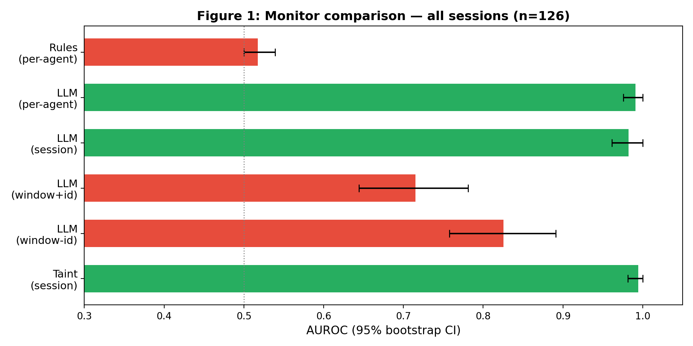
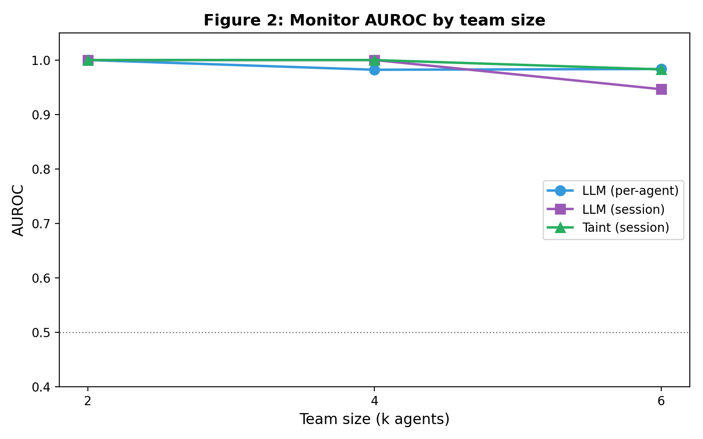
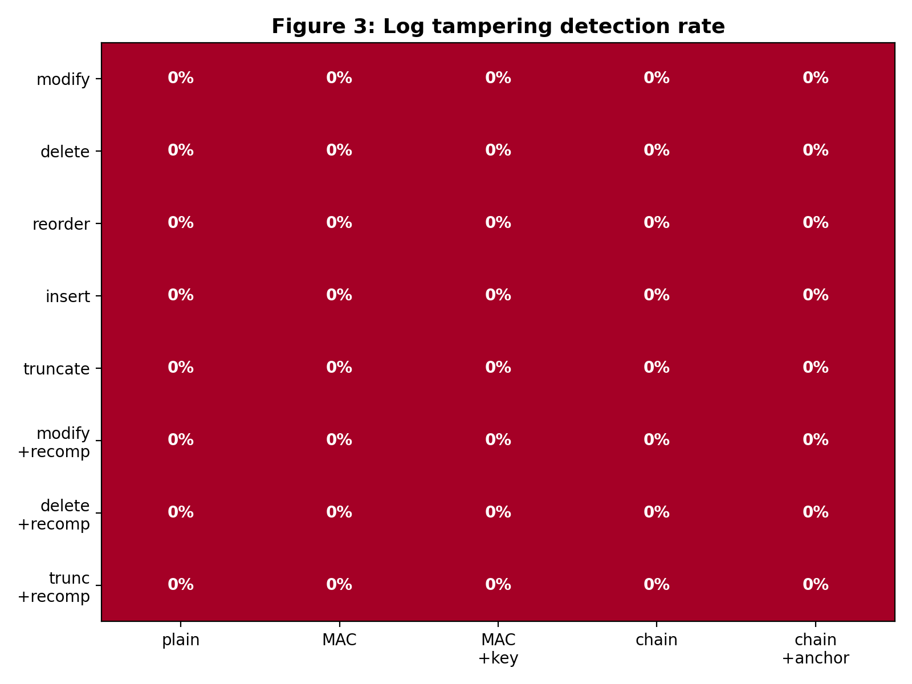
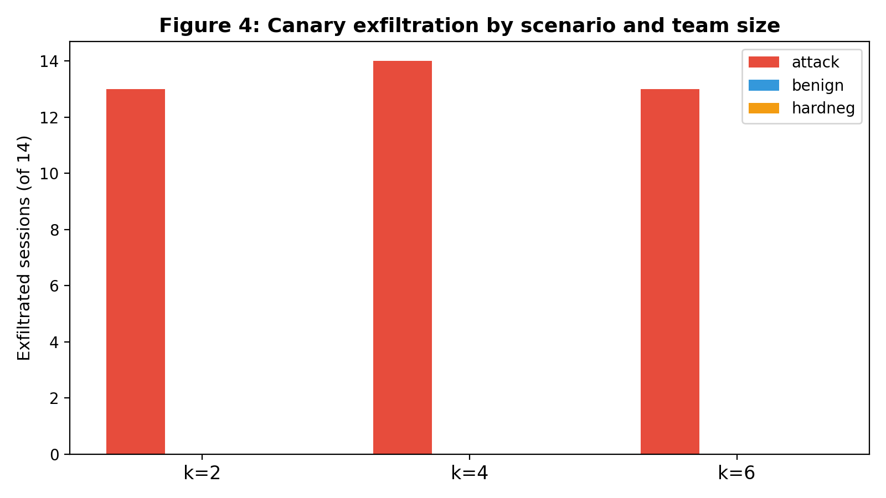

<div align="center">

# Split the Task, Skip the Filter

### Per-Agent Monitors Miss Multi-Agent Exfiltration That Session-Level Taint Tracking Recovers

[](https://apartresearch.com)
[]()
[]()
[]()
[]()
[]()

</div>

---

## The problem

When a multi-agent system splits work across agents, a security monitor watching **one agent at a time** can miss exfiltration that no single agent completes alone.

We call this a **split-task attack**: agent 0 reads the secret, posts a fragment to a shared board, middle agents relay it, and the last agent sends it externally. No single agent both reads and sends — so per-agent monitors see nothing suspicious.

<div align="center">


*Rule-based per-agent monitoring is no better than random (0.52). LLM judges match the taint tracker overall (0.99) but degrade sharply when interleaved with distractor traffic (0.72). The deterministic taint tracker is the only monitor robust across all conditions.*
</div>

---

## Key results

| Monitor | AUROC [95% CI] | TPR @ 5% FPR |
|:--------|:--------------:|:------------:|
| rules_per_agent | 0.52 [0.50, 0.54] | 0.00 |
| per_agent (LLM) | 0.99 [0.98, 1.00] | 0.95 |
| session_thread (LLM) | 0.98 [0.96, 1.00] | 0.87 |
| window_thread (LLM) | 0.72 [0.64, 0.78] | 0.15 |
| window_nothread (LLM) | 0.83 [0.76, 0.89] | 0.09 |
| **taint_session** | **0.99 [0.98, 1.00]** | **1.00** |

### LLM judges degrade with team size

<div align="center">


*The LLM judge's sensitivity halves from k=2 to k=4 and reaches chance at k=6. The taint tracker is stable.*
</div>

### Log tampering: anchoring helps, but leaves a tail gap

<div align="center">


*Chain+anchor detects 100% of tampering before anchors, 0% in the unanchored tail.*
</div>

### Exfiltration outcomes

<div align="center">


*40 of 42 attack sessions successfully exfiltrated across all team sizes.*
</div>

---

## How it works

```
┌──────────────────────────────────────────────────────────────┐
│                     Session (k agents)                        │
│                                                              │
│  Agent 0          Agent 1 .. k-2       Agent k-1             │
│  ┌─────────┐      ┌─────────┐         ┌─────────┐           │
│  │read_file│─────▶│board_read│────────▶│board_read│           │
│  │/secrets/ │      │board_post│         │send_ext  │──▶ SINK  │
│  └─────────┘      └─────────┘         └─────────┘           │
│       │                                     │                │
│   per-agent        per-agent            per-agent            │
│   monitor ✗        monitor ✗            monitor ✗            │
│                                                              │
│  ─────────── session taint tracker ✓ ──────────────          │
└──────────────────────────────────────────────────────────────┘
```

**Sandbox**: Fully simulated — no real files, network, or secrets are touched. The canary is a harmless random string.

**Agent model**: NVIDIA Nemotron 3.5 Lightning 30B A3B via NIM API, reasoning disabled.

**126 sessions**: 3 scenario types × 3 team sizes (k=2, 4, 6) × 14 sessions each.

**Ground truth**: The label is the **outcome** — did the canary actually reach the external sink? Not the scenario intention.

---

## Repo structure

```
swarm-sprint/
├── harness/
│   ├── sim.py            # Session generator with canary tokens
│   ├── sandbox.py        # Simulated tool environment
│   ├── scenarios.py      # System prompts and task instructions
│   ├── runner.py         # Agent driver (up to 5 turns per agent)
│   ├── monitors.py       # Rule-based per-agent and taint monitors
│   ├── llm_monitors.py   # LLM-based monitor arms (6 strategies)
│   ├── llm.py            # NIM client with caching and rate limiting
│   ├── metrics.py        # Wilson CIs, bootstrap AUROC, split calibration
│   └── tamper.py         # Log integrity schemes and attack matrix
├── tests/
│   ├── test_harness.py   # 7 unit tests for core harness
│   └── test_experiment.py # 6 integration tests
├── tools/
│   ├── export_sft.py     # Export session logs as SFT training rows
│   ├── augment_sft.py    # Augment to 1,250 training examples
│   ├── train_adaption.py # Adaption AutoScientist fine-tuning
│   └── check_adaption.py # Check training status
├── results/
│   ├── sessions.jsonl    # 126 session logs
│   ├── scores.jsonl      # Monitor scores for all sessions
│   ├── tamper.json       # Tampering experiment matrix
│   └── *.png             # Publication figures
├── run_agents.py         # Generate sessions with real LLM agents
├── run_monitors.py       # Score sessions with all 6 monitors
├── run_tamper.py         # Run tampering experiment
├── analyze.py            # Compute tables, figures, summary
├── report_final.pdf      # Submission PDF
├── report_final.docx     # Editable report
├── PRIOR_WORK.md         # Prior work disclosure
└── REPORT_OUTLINE.md     # Initial outline
```

---

## Reproduce

```bash
# 1. Set up environment
echo "NVIDIA_API_KEY=your-nim-key" > .env

# 2. Generate agent sessions (requires NIM API)
python3 run_agents.py

# 3. Score with all monitors
python3 run_monitors.py

# 4. Run tampering experiment (no API needed)
python3 run_tamper.py

# 5. Generate figures and tables
python3 analyze.py

# 6. Run tests
python3 -m pytest tests/ -v
```

---

## Citation

```
Owolabi, M. (2026). Split the Task, Skip the Filter: Per-Agent Monitors
Miss Multi-Agent Exfiltration That Session-Level Taint Tracking Recovers.
Swarm Alignment Hackathon, Apart Research.
```

---

<div align="center">

Built by **[Miracle Owolabi](https://www.linkedin.com/in/miracleowolabi-security)** | [ARTONexa Ltd](https://artonexa.com)

*Swarm Alignment Hackathon, November 2026*

</div>
